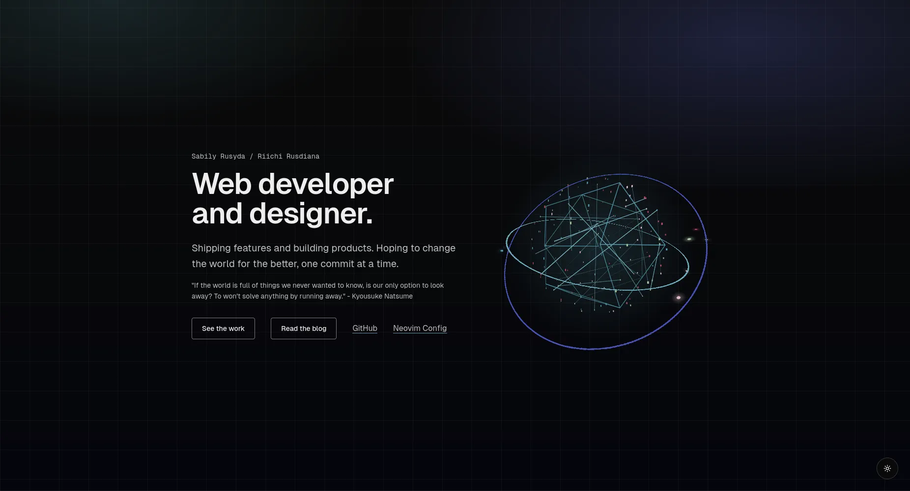

# riichi.my.id — Personal Portfolio

Personal portfolio of **Riichi Rusdiana** — web developer and designer. Selected work, toolkit, and contact details.

## Tech stack

- **Framework:** Next.js 16 (App Router, static export)
- **Language:** TypeScript
- **Styling:** Tailwind CSS v4
- **Animation:** Motion, animejs
- **Content:** MDX blog (`content/blog/*.mdx`) with `@next/mdx`
- **Icons:** Lucide, Iconoir, React Icons
- **Image optimization:** sharp (build-time, WebP)
- **Hosting:** Cloudflare Pages (static export)

## Running locally

```bash
bun install
bun run dev        # http://localhost:3000
```

### Build (static export)

```bash
bun run build      # outputs to out/
bun run lint       # eslint
bun run assets:test # verify generated blog images
```

### Adding a blog post

Drop a `.mdx` file into `content/blog/` with frontmatter (`title`, `description`, `publishedAt`). Optional images go in `assets/blog/<slug>/`.

## Deployment

Pushes to the `deploy-page` branch trigger a Cloudflare Pages build (`bun run build`, output `out/`). See `AGENTS.md` for the full SOP.
